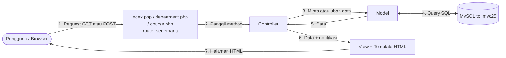
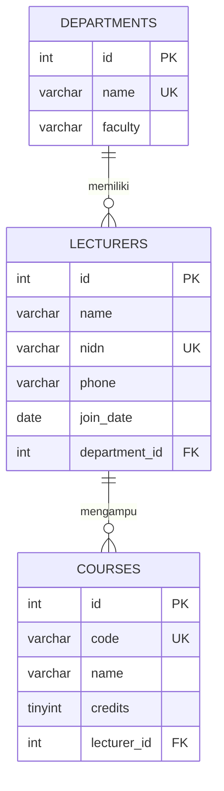
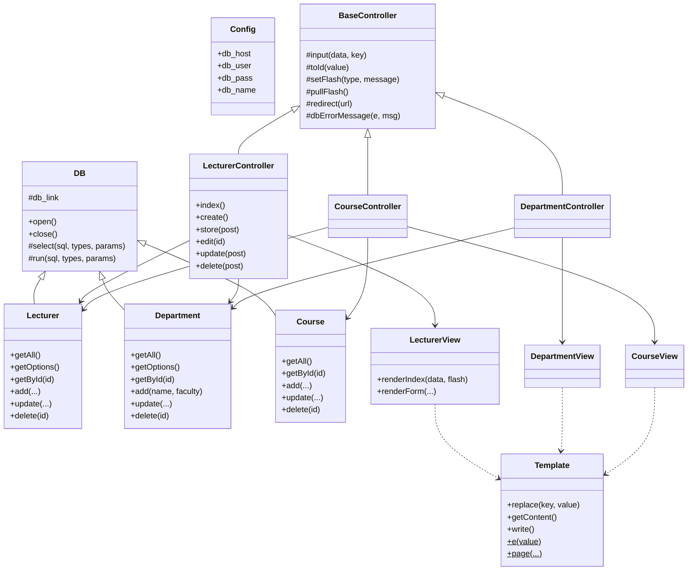
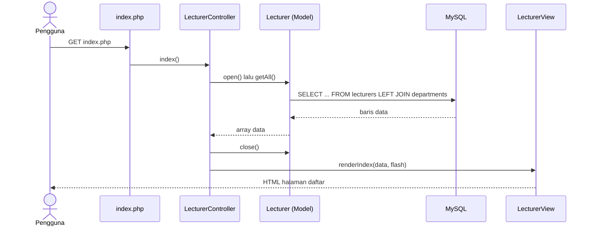
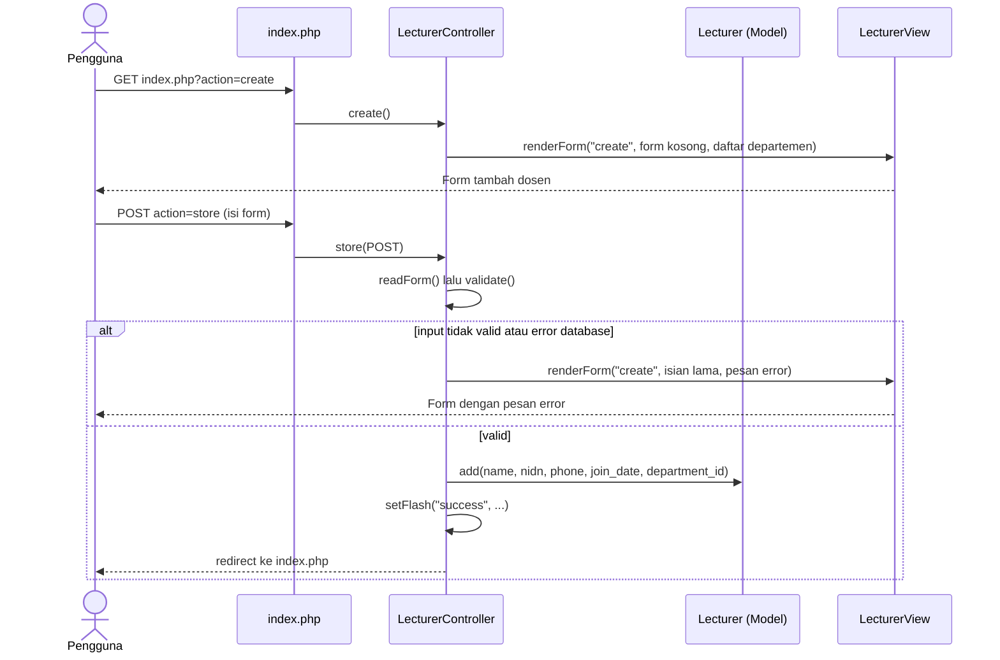

# TP8DPBO2425C.. — Lecturers (MVC)

> **Tugas Praktikum Modul 9 — Model-View-Controller (MVC)**
> Mata kuliah Desain Pemrograman Berbasis Objek, Ilmu Komputer FPMIPA UPI

| | |
|---|---|
| **Nama** | _(isi nama lengkap)_ |
| **NIM** | _(isi NIM)_ |
| **Kelas** | _(isi kelas)_ |

## Daftar Isi

1. [Deskripsi Proyek](#1-deskripsi-proyek)
2. [Teknologi yang Digunakan](#2-teknologi-yang-digunakan)
3. [Struktur Repository](#3-struktur-repository)
4. [Analisis Kode Awal dan Perubahan yang Dilakukan](#4-analisis-kode-awal-dan-perubahan-yang-dilakukan)
5. [Desain Program](#5-desain-program)
6. [Penjelasan Alur Program](#6-penjelasan-alur-program)
7. [Validasi dan Penanganan Error](#7-validasi-dan-penanganan-error)
8. [Keamanan](#8-keamanan)
9. [Penjelasan Fitur per Halaman](#9-penjelasan-fitur-per-halaman)
10. [Cara Menjalankan Program](#10-cara-menjalankan-program)
11. [Skenario Pengujian](#11-skenario-pengujian)
12. [Dokumentasi](#12-dokumentasi)
13. [Referensi](#13-referensi)

---

## 1. Deskripsi Proyek

Program ini adalah aplikasi web **manajemen data dosen (Lecturers)** berbasis PHP dan MySQL. Kode awal (`tp_mvc25`) hanya berupa satu tabel `lecturers` dengan lima file PHP prosedural (`index.php`, `create.php`, `edit.php`, `delete.php`, `connection.php`) yang mencampur query SQL, logika, dan HTML dalam satu file.

Pada tugas ini seluruh kode tersebut **diubah menjadi arsitektur MVC** (Model-View-Controller), lalu dikembangkan dengan:

| Ketentuan Tugas | Yang Dikerjakan |
|---|---|
| 1. Buat database berdasarkan kode | Database `tp_mvc25` dengan tabel `lecturers` (`id`, `name`, `nidn`, `phone`, `join_date`) dibuat dari query yang ada di kode awal. File SQL: [`tp_mvc25.sql`](tp_mvc25.sql). |
| 2. Ubah arsitektur menjadi MVC | Kode dipecah menjadi `models/`, `views/` (+ `templates/`), dan `controllers/`. Lihat [bagian 5](#5-desain-program). |
| 3. Tambah 1–2 tabel baru yang berelasi | Ditambahkan **2 tabel baru**: `departments` (relasi 1-N ke `lecturers`) dan `courses` (relasi N-1 ke `lecturers`). |
| 4. Buat CRUD untuk tabel baru | CRUD lengkap (Create, Read, Update, Delete) untuk `departments` dan `courses`. CRUD `lecturers` juga tetap ada dan dirapikan. |
| 5. Boleh mengubah/menambah atribut tabel lama | Tabel `lecturers` ditambah kolom `department_id` (foreign key ke `departments`), serta constraint `UNIQUE` pada `nidn`. |

Fitur utama:

- Tiga halaman data: **Lecturers** (Home), **Departments**, dan **Courses**, masing-masing dengan tambah, lihat, ubah, dan hapus data.
- Relasi antartabel tampil langsung di antarmuka: tabel dosen menampilkan nama departemen, tabel departemen menampilkan jumlah dosen, tabel mata kuliah menampilkan nama dosen pengampu. Dropdown pada form diisi dari tabel induknya.
- Validasi input di sisi server, notifikasi berhasil/gagal, dan konfirmasi sebelum menghapus.
- Kode memakai prepared statement dan escape output, sehingga aman dari SQL Injection dan XSS.

## 2. Teknologi yang Digunakan

| Komponen | Keterangan |
|---|---|
| PHP | 7.4 ke atas (target utama: PHP 8.x bawaan XAMPP), ekstensi `mysqli`, `mysqlnd`, dan `mbstring` (aktif secara default di XAMPP) |
| MySQL / MariaDB | Engine InnoDB (wajib untuk foreign key) |
| Web server | Apache (XAMPP) |
| Bootstrap | 5.0.2, file lokal di `Project/assets/` (tanpa CDN, tetap berjalan offline) |
| Arsitektur | MVC dengan mesin template sederhana (`Template.php`), mengikuti pola contoh `mvc9` pada modul |

## 3. Struktur Repository

```
TP8DPBO2425C../
├── Project/                  <- project yang sudah mengikuti arsitektur MVC
│   ├── assets/               <- Bootstrap CSS & JS (file lokal)
│   ├── controllers/          <- C : penghubung Model dan View
│   ├── models/               <- M : akses database
│   ├── templates/            <- kerangka HTML (dipakai oleh View)
│   ├── views/                <- V : menyusun tampilan
│   ├── config.php            <- konfigurasi database
│   ├── index.php             <- titik masuk halaman Lecturers (Home)
│   ├── department.php        <- titik masuk halaman Departments
│   └── course.php            <- titik masuk halaman Courses
├── Dokumentasi/              <- screen record / screenshot hasil program
├── tp_mvc25.sql              <- file SQL database
└── ReadMe.md                 <- dokumen ini
```

Struktur ini sesuai ketentuan tugas: folder Project, folder Dokumentasi, file SQL, dan `ReadMe.md`.

## 4. Analisis Kode Awal dan Perubahan yang Dilakukan

### 4.1 Masalah pada kode awal

Setelah kode awal dibaca, ditemukan beberapa masalah yang ikut diperbaiki saat proses konversi ke MVC.

| No | File awal | Masalah | Perbaikan pada versi MVC |
|---|---|---|---|
| 1 | Semua file | SQL, logika PHP, dan HTML bercampur dalam satu file sehingga sulit dirawat dan tidak sesuai prinsip MVC. | Dipisah menjadi Model (SQL), View (HTML), dan Controller (logika). |
| 2 | `create.php`, `edit.php`, `delete.php` | Nilai dari `$_POST` dan `$_GET` langsung disambung ke string SQL, sehingga rentan **SQL Injection**. | Semua query memakai **prepared statement** (`prepare`, `bind_param`, `execute`) di `models/DB.php`. |
| 3 | `index.php` | Data dari database dicetak tanpa escape, sehingga rentan **XSS**. | Semua output melewati `Template::e()` (`htmlspecialchars`). |
| 4 | `edit.php` | Redirect menuju `crud100/index.php`, sebuah path project lain. | Redirect diarahkan ke halaman yang benar (`index.php`, `department.php`, `course.php`). |
| 5 | `delete.php` | Setelah hapus, redirect ke `/bakekok/index.php` (path project lain), sehingga halaman tidak ditemukan. | Setelah hapus, pengguna diarahkan kembali ke halaman daftar dengan notifikasi. |
| 6 | `create.php` | Setelah data disimpan tidak ada redirect atau notifikasi. Refresh halaman bisa menyimpan data ganda. | Memakai pola **Post/Redirect/Get** dan flash message. |
| 7 | `edit.php` | Pengecekan data kosong memakai `while (!$row)` dan hasil query tidak dicek dengan benar. | Controller mengecek hasil dengan jelas dan menampilkan pesan "data tidak ditemukan". |
| 8 | `delete.php` | Penghapusan lewat link GET (`delete.php?id=..`), sehingga data bisa terhapus hanya dengan membuka URL. | Penghapusan lewat **form POST** dengan dialog konfirmasi. |
| 9 | `create.php`, `edit.php` | Memuat jQuery, Popper, dan Bootstrap JS v4.0.0 bersama Bootstrap CSS v5.0.2 (versi bercampur). | Hanya memakai `bootstrap.min.css` dan `bootstrap.bundle.min.js` (v5.0.2). jQuery dan Popper terpisah tidak diperlukan. |
| 10 | Semua file | Menu navbar berisi tautan placeholder `?` yang tidak mengarah ke mana pun. | Diganti menu **Home**, **Departments**, dan **Courses**. |
| 11 | `edit.php` | Tidak ada validasi input sama sekali. | Validasi di server pada semua form (lihat [bagian 7](#7-validasi-dan-penanganan-error)). |
| 12 | Semua file | Navbar tidak punya tombol toggle, sehingga menu tidak muncul di layar kecil. | Ditambahkan tombol toggle navbar. |
| 13 | `connection.php` | Koneksi memakai variabel global dan `die()` saat gagal. | Dibungkus class `Config` dan class `DB`, dengan error ditangani lewat exception dan halaman error. |

### 4.2 Pemetaan file lama ke struktur MVC

| File / fungsi lama | Menjadi (Model / View / Controller) |
|---|---|
| `connection.php` | `config.php` (data koneksi) dan `models/DB.php` (membuka dan menutup koneksi) |
| `index.php` (query `select * from lecturers`) | `Lecturer::getAll()` (Model) |
| `index.php` (HTML tabel) | `LecturerView::renderIndex()` dan `templates/lecturer_index.html` (View) |
| `index.php` (alur menampilkan data) | `LecturerController::index()` (Controller) |
| `create.php` (INSERT) | `Lecturer::add()` (Model) |
| `create.php` (HTML form) | `LecturerView::renderForm()` dan `templates/lecturer_form.html` (View) |
| `create.php` (mengambil data POST) | `LecturerController::create()` dan `store()` (Controller) |
| `edit.php` (SELECT dan UPDATE) | `Lecturer::getById()` dan `Lecturer::update()` (Model) |
| `edit.php` (alur) | `LecturerController::edit()` dan `update()` (Controller) |
| `delete.php` | `Lecturer::delete()` (Model) dan `LecturerController::delete()` (Controller) |

## 5. Desain Program

### 5.1 Arsitektur MVC

Prinsip utama pada project ini:

- **Model** menyimpan semua query SQL dan hanya berhubungan dengan database. Model tidak mengenal HTML.
- **View** menyusun HTML dari data yang diberikan. View tidak pernah memanggil database.
- **Controller** menerima request dari pengguna, memvalidasi input, memanggil Model, lalu menyerahkan hasilnya ke View. Controller tidak berisi SQL maupun HTML.



### 5.2 Struktur Project dan Tanggung Jawab Tiap File

| File | Bagian | Tanggung jawab |
|---|---|---|
| `config.php` | Konfigurasi | Class `Config` berisi host, user, password, dan nama database. |
| `index.php` | Router | Titik masuk halaman Lecturers. Membaca GET/POST lalu memanggil `LecturerController`. |
| `department.php` | Router | Titik masuk halaman Departments. Memanggil `DepartmentController`. |
| `course.php` | Router | Titik masuk halaman Courses. Memanggil `CourseController`. |
| `models/DB.php` | Model dasar | Membuka dan menutup koneksi, serta method `select()` dan `run()` yang memakai prepared statement. |
| `models/Lecturer.php` | Model | Query tabel `lecturers`: `getAll`, `getOptions`, `getById`, `add`, `update`, `delete`. |
| `models/Department.php` | Model | Query tabel `departments`: `getAll` (dengan `COUNT` dosen), `getOptions`, `getById`, `add`, `update`, `delete`. |
| `models/Course.php` | Model | Query tabel `courses`: `getAll`, `getById`, `add`, `update`, `delete`. |
| `controllers/BaseController.php` | Controller dasar | Fungsi bantu bersama: membaca input, flash message, redirect, validasi tanggal, dan penerjemah error database. |
| `controllers/LecturerController.php` | Controller | Alur CRUD dosen: `index`, `create`, `store`, `edit`, `update`, `delete`, beserta validasi. |
| `controllers/DepartmentController.php` | Controller | Alur CRUD departemen. |
| `controllers/CourseController.php` | Controller | Alur CRUD mata kuliah. |
| `views/Template.php` | View | Mesin template (`{{PENANDA}}`) dan helper HTML: `e()`, `page()`, `alert()`, `errors()`, `options()`, `actionButtons()`. |
| `views/LecturerView.php` | View | `renderIndex()` (tabel) dan `renderForm()` (form) untuk dosen. |
| `views/DepartmentView.php` | View | Tampilan tabel dan form departemen. |
| `views/CourseView.php` | View | Tampilan tabel dan form mata kuliah. |
| `views/ErrorView.php` | View | Halaman error ramah pengguna. |
| `templates/layout.html` | Template | Kerangka halaman: `<head>`, navbar, area notifikasi, dan tempat isi halaman. |
| `templates/*_index.html` | Template | Kerangka halaman daftar (judul, tombol Add New, tabel). |
| `templates/*_form.html` | Template | Kerangka form tambah dan ubah. |
| `templates/error.html` | Template | Kerangka halaman error. |
| `assets/` | Aset | `bootstrap.min.css` dan `bootstrap.bundle.min.js` v5.0.2. |

### 5.3 Desain Database

Database bernama **`tp_mvc25`**, dengan tiga tabel.



**Tabel `departments` (tabel baru)**

| Kolom | Tipe | Keterangan |
|---|---|---|
| `id` | INT, AUTO_INCREMENT | Primary key |
| `name` | VARCHAR(100), NOT NULL, UNIQUE | Nama departemen |
| `faculty` | VARCHAR(100), NOT NULL | Nama fakultas |

**Tabel `lecturers` (tabel lama, ditambah kolom)**

| Kolom | Tipe | Keterangan |
|---|---|---|
| `id` | INT, AUTO_INCREMENT | Primary key (dari kode awal) |
| `name` | VARCHAR(100), NOT NULL | Nama dosen (dari kode awal) |
| `nidn` | VARCHAR(10), NOT NULL, UNIQUE | Nomor Induk Dosen Nasional (dari kode awal, ditambah constraint UNIQUE) |
| `phone` | VARCHAR(20), NOT NULL | Nomor telepon (dari kode awal) |
| `join_date` | DATE, NOT NULL | Tanggal bergabung (dari kode awal) |
| `department_id` | INT, NULL, **FK** ke `departments.id` | **Kolom baru** |

> Tipe data kolom lama disimpulkan dari query dan form pada kode awal, karena kode awal tidak menyertakan file SQL.

**Tabel `courses` (tabel baru)**

| Kolom | Tipe | Keterangan |
|---|---|---|
| `id` | INT, AUTO_INCREMENT | Primary key |
| `code` | VARCHAR(10), NOT NULL, UNIQUE | Kode mata kuliah, contoh `IK201` |
| `name` | VARCHAR(150), NOT NULL | Nama mata kuliah |
| `credits` | TINYINT UNSIGNED, NOT NULL | Jumlah SKS (1–6) |
| `lecturer_id` | INT, NULL, **FK** ke `lecturers.id` | Dosen pengampu |

**Relasi dan aturan foreign key**

| Relasi | Jenis | Aturan |
|---|---|---|
| `departments.id` → `lecturers.department_id` | 1-N (satu departemen, banyak dosen) | `ON DELETE SET NULL`, `ON UPDATE CASCADE` |
| `lecturers.id` → `courses.lecturer_id` | 1-N (satu dosen, banyak mata kuliah) | `ON DELETE SET NULL`, `ON UPDATE CASCADE` |

Dengan `ON DELETE SET NULL`, menghapus departemen atau dosen tidak ikut menghapus data anaknya. Dosen atau mata kuliah terkait hanya menjadi "tanpa departemen" atau "tanpa dosen", sehingga data tidak hilang secara tidak sengaja.

### 5.4 Diagram Class



### 5.5 Mesin Template

`views/Template.php` bekerja seperti pada contoh `mvc9`: View membaca file HTML di folder `templates/` yang berisi penanda `{{NAMA}}`, lalu mengganti penanda itu dengan data. Contoh pada `templates/lecturer_index.html`:

```html
<tbody>
  {{TABLE_ROWS}}
</tbody>
```

`LecturerView::renderIndex()` menyusun baris tabel dan memasukkannya lewat `$tpl->replace("TABLE_ROWS", $rows)`. Hasilnya lalu dibungkus `templates/layout.html` (navbar, notifikasi, dan script) oleh `Template::page()`.

Penggantian penanda dilakukan sekali jalan memakai `strtr()`. Dengan begitu, jika ada pengguna yang mengisi nama dengan teks seperti `{{TITLE}}`, teks itu tampil apa adanya dan tidak ikut diganti.

## 6. Penjelasan Alur Program

### 6.1 Rute (Routing)

Setiap halaman punya satu file titik masuk yang membaca jenis request dan parameter `action`. File ini tidak berisi SQL maupun HTML.

| Jenis request | Parameter | Method Controller | Hasil |
|---|---|---|---|
| GET | (tanpa `action`) | `index()` | Menampilkan daftar data |
| GET | `action=create` | `create()` | Menampilkan form tambah |
| GET | `action=edit&id=N` | `edit(id)` | Menampilkan form ubah terisi data lama |
| POST | `action=store` | `store($_POST)` | Menyimpan data baru, lalu redirect ke daftar |
| POST | `action=update` | `update($_POST)` | Menyimpan perubahan, lalu redirect ke daftar |
| POST | `action=delete` | `delete($_POST)` | Menghapus data, lalu redirect ke daftar |

Pola yang dipakai: **GET untuk menampilkan, POST untuk mengubah data**. Setelah POST berhasil, pengguna dialihkan ke halaman daftar (Post/Redirect/Get). Karena itu menekan refresh tidak mengirim ulang form.

### 6.2 READ — Menampilkan Daftar (contoh: Lecturers)



1. Pengguna membuka `index.php`. Router memanggil `LecturerController::index()`.
2. Controller membuka koneksi dan meminta `Lecturer::getAll()`.
3. Model menjalankan `SELECT` dengan `LEFT JOIN` ke `departments`, sehingga dosen tanpa departemen tetap tampil.
4. Controller menutup koneksi lalu menyerahkan data dan flash message ke `LecturerView::renderIndex()`.
5. View menyusun baris tabel, memasukkannya ke `lecturer_index.html`, lalu membungkusnya dengan `layout.html`.

Halaman Departments (`getAll` dengan `COUNT` dan `GROUP BY`) dan Courses (`getAll` dengan `LEFT JOIN` ke `lecturers`) memakai alur yang sama.

### 6.3 CREATE — Menambah Data



1. Klik **Add New** membuka form (`action=create`). Dropdown **Department** diisi dari `Department::getOptions()`.
2. Saat **Submit**, form dikirim lewat POST dengan `action=store`.
3. Controller merapikan input (`trim`) dan memvalidasinya.
4. Jika ada error validasi, form ditampilkan lagi beserta isian sebelumnya dan daftar pesan error. Data pengguna tidak hilang.
5. Jika valid, Model menjalankan `INSERT` dengan prepared statement.
6. Jika database menolak (misalnya NIDN kembali sama, error 1062), pesan error ditampilkan di form.
7. Jika berhasil, Controller menyimpan flash message "berhasil" di session lalu mengalihkan ke daftar. Pesan tampil sekali sebagai alert hijau.

### 6.4 UPDATE — Mengubah Data

1. Klik **Edit** membuka `index.php?action=edit&id=N`.
2. `LecturerController::edit()` memastikan `id` berupa angka lalu memanggil `Lecturer::getById()`. Jika data tidak ada (misalnya id diubah manual di URL), pengguna dialihkan ke daftar dengan pesan "Data dosen tidak ditemukan".
3. Form tampil dengan isian lama. Id dikirim lewat input `hidden`.
4. Saat **Submit**, POST `action=update` diproses `update()`: validasi, cek bahwa data masih ada, lalu `Lecturer::update()` menjalankan `UPDATE ... WHERE id = ?`.
5. Hasilnya sama seperti CREATE: error ditampilkan di form, atau redirect ke daftar dengan notifikasi sukses.

### 6.5 DELETE — Menghapus Data

1. Tombol **Delete** adalah form kecil berisi `action=delete` dan `id` (lewat POST), bukan link biasa.
2. Browser menampilkan dialog konfirmasi: "Yakin ingin menghapus data ini?".
3. Jika dikonfirmasi, `delete()` memanggil Model untuk menjalankan `DELETE ... WHERE id = ?`.
4. Controller menyiapkan flash message (berhasil atau data tidak ditemukan) dan mengalihkan ke daftar.

Perilaku relasi saat menghapus:

- Menghapus **departemen** menjadi "tanpa departemen" bagi dosen di dalamnya (`SET NULL`).
- Menghapus **dosen** membuat mata kuliah yang diampunya menjadi "tanpa dosen" (`SET NULL`).
- Menghapus **mata kuliah** tidak berdampak pada tabel lain.

## 7. Validasi dan Penanganan Error

Validasi dilakukan di server (Controller). Atribut HTML seperti `required` dan `pattern` hanya bantuan tambahan di browser.

| Form | Field | Aturan |
|---|---|---|
| Lecturer | name | Wajib diisi, maksimal 100 karakter |
| Lecturer | nidn | Tepat 10 digit angka; harus unik |
| Lecturer | phone | 8–20 karakter, hanya angka, spasi, tanda minus, dan boleh diawali `+` |
| Lecturer | join_date | Format tanggal valid (`Y-m-d`), misalnya `2024-02-30` ditolak |
| Lecturer | department_id | Boleh kosong; jika diisi harus angka dan departemen harus ada |
| Department | name | Wajib diisi, maksimal 100 karakter, unik |
| Department | faculty | Wajib diisi, maksimal 100 karakter |
| Course | code | 3–10 karakter (huruf, angka, atau tanda minus), otomatis diubah menjadi huruf besar, unik |
| Course | name | Wajib diisi, maksimal 150 karakter |
| Course | credits | Bilangan bulat 1–6 |
| Course | lecturer_id | Boleh kosong; jika diisi harus angka dan dosen harus ada |

Penanganan error database (`BaseController::dbErrorMessage()`):

| Kode error MySQL | Penyebab | Pesan untuk pengguna |
|---|---|---|
| 1062 | Nilai `UNIQUE` sudah ada (NIDN, kode mata kuliah, atau nama departemen) | Pesan sesuai konteks, misalnya "NIDN sudah terdaftar pada dosen lain." |
| 1452 | Foreign key tidak ditemukan | "Data referensi yang dipilih tidak ditemukan." |
| 1451 | Data masih dipakai tabel lain | "Data tidak dapat dihapus karena masih digunakan data lain." |
| Lainnya | Kesalahan lain | "Terjadi kesalahan pada database. Silakan coba lagi." |

Jika terjadi error yang tidak terduga (misalnya MySQL belum menyala atau database belum di-import), router menangkapnya dan menampilkan halaman error yang memuat petunjuk perbaikan.

## 8. Keamanan

| Ancaman | Penanganan |
|---|---|
| SQL Injection | Semua query memakai prepared statement (`bind_param`). Input tidak pernah disambung ke string SQL. |
| XSS | Semua data ditampilkan lewat `Template::e()` (`htmlspecialchars` dengan `ENT_QUOTES`). |
| Penghapusan lewat URL | Delete memakai form POST, bukan link GET. |
| Input id tidak valid | Id diperiksa dengan `ctype_digit()` dan diubah menjadi integer. Id yang salah menghasilkan pesan "tidak ditemukan". |
| Input bertipe tidak terduga | `input()` hanya menerima string, sehingga `name[]=x` pada POST diabaikan. |
| Data ganda akibat refresh | Pola Post/Redirect/Get. |
| Integritas data | Foreign key, constraint `UNIQUE`, dan `NOT NULL` di level database. |

## 9. Penjelasan Fitur per Halaman

### 9.1 Lecturers (Home) — `index.php`

Menampilkan kolom ID, Name, NIDN, Phone, Join Date, **Department**, dan Actions. Tombol **Add New** membuka form tambah dosen. Form memiliki dropdown **Department** (opsional). Tombol **Edit** membuka form ubah, tombol **Delete** menghapus data setelah konfirmasi.

### 9.2 Departments (tabel baru) — `department.php`

Menampilkan ID, Name, Faculty, dan **Total Lecturers** (jumlah dosen di departemen itu, dihitung dengan `COUNT` dan `LEFT JOIN`). CRUD lengkap. Menghapus departemen tidak menghapus dosen. Dosen tersebut menjadi tanpa departemen.

### 9.3 Courses (tabel baru) — `course.php`

Menampilkan ID, Code, Name, Credits (SKS), dan **Lecturer** (nama dosen pengampu). Form memiliki dropdown dosen yang diisi dari tabel `lecturers`. CRUD lengkap.

### 9.4 Notifikasi

Setiap operasi menampilkan alert di bagian atas halaman: hijau untuk berhasil dan merah untuk gagal. Alert dapat ditutup dan hanya tampil satu kali.

## 10. Cara Menjalankan Program

**Prasyarat:** XAMPP (Apache dan MySQL) terpasang.

1. **Salin project.** Salin folder `Project` ke `C:\xampp\htdocs\` lalu ubah namanya menjadi `tp_mvc25`. Hasil akhirnya `C:\xampp\htdocs\tp_mvc25\index.php`.
2. **Nyalakan XAMPP.** Buka XAMPP Control Panel, lalu start **Apache** dan **MySQL**.
3. **Import database.** Buka `http://localhost/phpmyadmin`, pilih tab **Import**, pilih file `tp_mvc25.sql` (di root repository), lalu klik **Import**. Database `tp_mvc25` beserta tabel dan data contoh akan terbentuk.
4. **Cek konfigurasi.** Buka `config.php`. Nilai bawaan (`localhost`, `root`, password kosong, `tp_mvc25`) cocok untuk XAMPP standar. Ubah jika setting MySQL kamu berbeda.
5. **Buka aplikasi.** Akses `http://localhost/tp_mvc25/` di browser.

**Jika bermasalah**

| Gejala | Penyebab dan solusi |
|---|---|
| Muncul halaman "Terjadi kesalahan" | MySQL belum menyala atau database belum di-import. Ulangi langkah 2 dan 3. |
| Tampilan tidak memakai Bootstrap | Folder `assets/` harus berada di dalam folder project, sejajar dengan `index.php`. |
| `Call to undefined function mb_strlen` | Aktifkan ekstensi `mbstring` di `php.ini`, lalu restart Apache. |
| `Call to undefined method mysqli_stmt::get_result` | Ekstensi `mysqlnd` tidak aktif. XAMPP menyertakannya secara default. |

## 11. Skenario Pengujian

Skenario berikut dipakai untuk memeriksa program secara manual. Centang kolom hasil setelah dicoba.

| No | Skenario | Hasil yang diharapkan | Hasil |
|---|---|---|---|
| 1 | Buka Home setelah import SQL | Tampil 6 dosen beserta nama departemennya | ☐ |
| 2 | Buka Departments | Tampil 3 departemen dengan Total Lecturers 3, 2, dan 1 | ☐ |
| 3 | Buka Courses | Tampil 8 mata kuliah beserta nama dosen pengampunya | ☐ |
| 4 | Tambah dosen dengan data valid | Redirect ke daftar, alert hijau, data baru tampil | ☐ |
| 5 | Tambah dosen dengan NIDN 9 digit atau berisi huruf | Form tampil kembali dengan pesan error, isian tidak hilang | ☐ |
| 6 | Tambah dosen dengan NIDN yang sudah ada | Pesan "NIDN sudah terdaftar pada dosen lain." | ☐ |
| 7 | Ubah data dosen | Redirect ke daftar, alert hijau, perubahan tampil | ☐ |
| 8 | Buka `index.php?action=edit&id=999` | Redirect ke daftar dengan pesan "Data dosen tidak ditemukan." | ☐ |
| 9 | Hapus dosen, klik Cancel pada konfirmasi | Data tidak terhapus | ☐ |
| 10 | Hapus dosen yang mengampu mata kuliah | Dosen terhapus, mata kuliahnya tetap ada dengan Lecturer "-" | ☐ |
| 11 | Tambah, ubah, dan hapus departemen | Semua operasi berhasil dengan notifikasi | ☐ |
| 12 | Hapus departemen yang memiliki dosen | Departemen terhapus, dosen tetap ada dengan Department "-" | ☐ |
| 13 | Tambah mata kuliah dengan SKS 0 atau 7 | Pesan "SKS harus berupa angka 1 sampai 6." | ☐ |
| 14 | Tambah mata kuliah dengan kode yang sudah ada | Pesan "Kode mata kuliah sudah digunakan." | ☐ |
| 15 | Tambah, ubah, dan hapus mata kuliah | Semua operasi berhasil dengan notifikasi | ☐ |
| 16 | Isi nama dengan `<script>alert(1)</script>` | Teks tampil apa adanya dan script tidak berjalan | ☐ |
| 17 | Refresh halaman setelah tambah data | Data tidak tersimpan dua kali | ☐ |
| 18 | Matikan MySQL lalu buka aplikasi | Tampil halaman "Terjadi kesalahan" dengan petunjuk | ☐ |

## 12. Dokumentasi

Dokumentasi (screen record dan screenshot) disimpan di folder [`Dokumentasi/`](Dokumentasi/).

<!--
PETUNJUK: letakkan file hasil rekaman / screenshot di folder Dokumentasi/ dengan nama
yang sama seperti di bawah, lalu hapus komentar ini. Screen record diutamakan.
-->

**Screen record:** [Dokumentasi/screen-record.mp4](Dokumentasi/screen-record.mp4)

### 12.1 Halaman Lecturers

| Daftar dosen | Form tambah |
|---|---|
|  |  |

| Form ubah | Konfirmasi hapus dan notifikasi |
|---|---|
|  |  |

### 12.2 Halaman Departments

| Daftar departemen | Form tambah / ubah |
|---|---|
|  |  |

### 12.3 Halaman Courses

| Daftar mata kuliah | Form tambah / ubah |
|---|---|
|  |  |

### 12.4 Validasi dan Database

| Pesan validasi | Struktur database di phpMyAdmin |
|---|---|
|  |  |

## 13. Referensi

- Tim Asisten Praktikum Desain Pemrograman Berbasis Objek (2023). *Modul 9: MVC*. Ilmu Komputer FPMIPA UPI.
- GeeksForGeeks (2025). *MVC Framework Introduction*. https://www.geeksforgeeks.org/software-engineering/mvc-framework-introduction/
- Dicoding (2021). *Apa Itu MVC? Pahami Konsepnya dengan Baik*. https://www.dicoding.com/blog/apa-itu-mvc-pahami-konsepnya/
- PHP Manual — mysqli prepared statements. https://www.php.net/manual/en/mysqli.quickstart.prepared-statements.php
- Bootstrap 5.0 Documentation. https://getbootstrap.com/docs/5.0/
